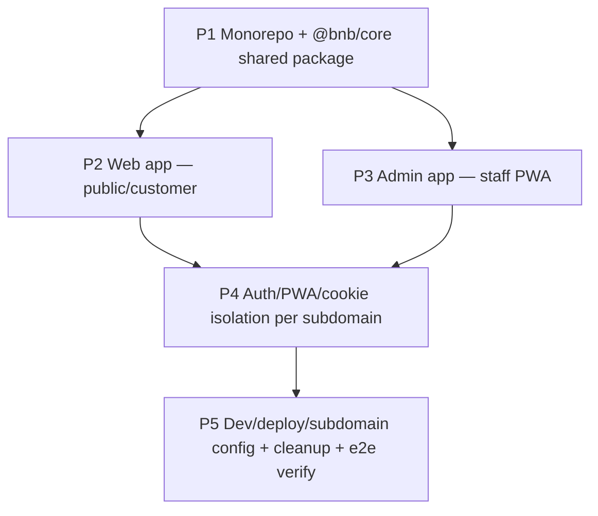
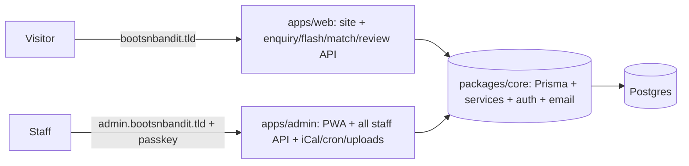

# Backend App Separation (Monorepo + Subdomains) Master Plan

Created: 2026-06-19
Status: PENDING
Approved: No
Iterations: 1
Worktree: No
Type: Master

## Goal

Restructure the single Next.js app into an **npm-workspaces monorepo**: a shared domain package `@bnb/core` (Prisma + services + auth-core + email + pricing + calendar/cron + shared types), a public **web** app (apex/www) and a staff **admin** app (admin.<domain>) — the back-of-house installable PWA — with auth cookies / WebAuthn RP-ID / PWA scope isolated per subdomain so staff and customer sessions never overlap. Preserve all current functionality; each workspace stays green.

## Architecture

## Context (shared by all phases)

**Decisions (user-approved):** npm workspaces (`workspaces: ["apps/*","packages/*"]`, no new tool). `@bnb/core` = **domain logic only** (db, services, auth, email, pricing, calendar/ical, cron, artist-status, utils/cn, api `_lib` http helper, shared types). **UI is per-app** (each app keeps its own `components/ui` shadcn copies + `globals.css` heritage tokens). Public site on **apex+www**; staff PWA on **admin.<domain>**. Public API (enquiries, flash, match, reviews) → web; **ALL staff endpoints** (auth, customers, bookings, sessions, availability, leave, reports, content, studio, profile, uploads, cron, **per-artist iCal feed**) → admin. Passkey/staff session cookies + WebAuthn RP-ID scoped to the admin origin; web reserved for future customer auth.

**Current layout (source of the move):**
- `src/lib/{db,services,auth,email,pricing,calendar,cron,artist-status,utils}` + `db.ts`, `pricing.ts`, `utils.ts`, `artist-status.ts` → **@bnb/core**. `src/lib/{admin-nav,pwa}` → admin app; `src/lib/site-nav` → web app.
- `src/app/(site)/**` (aftercare, artists, enquire, flash, gallery, inkling, passport, review, studio, `_data`, `_format`, `layout`, `page`, `site.css`) + public api (`enquiries`, `flash`, `match`, `reviews`) + `src/components/site` → **apps/web**.
- `src/app/(admin)/admin/**` (availability, bookings, calendar, content, customers, enquiries, front-desk, profile, reports, sessions, studio, `_shared`, `page`) + admin api (`auth`, `availability`, `bookings`, `calendar`, `cron`, `customers`, `integrations`, `leave`, `reports`, `sessions`, `uploads`) + `src/components/admin` → **apps/admin**. **Routes rebase `/admin/*` → `/*`** (admin is its own origin); `admin-nav` hrefs + all internal links updated; sign-in at `/sign-in`.
- `src/components/ui` (shadcn) + `src/app/{globals.css,layout.tsx,favicon.ico}` → **copied into BOTH apps** (each app owns its root layout/theme).
- Prisma schema + migrations move to `packages/core/prisma`; client generated there and exported as `@bnb/core/db`; both apps run/point at the same DB. `prisma` npm scripts move to the core package (root scripts delegate).

**Conventions:** money integer pence; passkey-only staff auth; owner-or-self RBAC; ≥483 tests preserved across the monorepo (each workspace runs its own vitest; root aggregates). Per-app `.env` with `APP_ORIGIN`, `RP_ID`, distinct `SESSION_COOKIE`; shared `DATABASE_URL`/`RESEND_API_KEY`/`CRON_SECRET`.

## Waves

**Wave 1 — Foundation (solo):** P1 establishes workspaces + `@bnb/core` and rewires the current app to import it; everything depends on this.
**Wave 2 — Apps (parallel):** P2 (web) and P3 (admin) move disjoint route groups/components into their own apps; both depend only on P1.
**Wave 3 — Isolation (solo):** P4 splits auth cookies / RP-ID / PWA scope per subdomain across both apps.
**Wave 4 — Cutover (solo):** P5 wires dev/deploy/subdomain config, removes the legacy root app, and verifies both apps end-to-end.

## Phases

| Phase | Wave | Title | Objective | Dependencies |
| ----- | ---- | ----- | --------- | ------------ |
| 1 | 1 | Monorepo + @bnb/core | npm workspaces; move `src/lib`+`prisma` into `packages/core` (`@bnb/core`); rewire current app's `@/lib/*`→`@bnb/core/*`; scaffold `apps/web`+`apps/admin` shells (own configs/tsconfig/tailwind/globals/layout; admin gets PWA manifest+sw scaffold); root app still green | None |
| 2 | 2 | Web app (public) | Move `(site)` + public API (enquiries/flash/match/reviews) + `components/site` + `components/ui` + site-nav into `apps/web` (apex routes); web builds + tests green | P1 |
| 3 | 2 | Admin app (staff PWA) | Move `(admin)/admin/**` (rebase `/admin/*`→`/*`) + all staff API + `components/admin` + `components/ui` + admin-nav + pwa into `apps/admin`; installable PWA; admin builds + tests green | P1 |
| 4 | 3 | Auth/PWA/cookie isolation | Per-app `APP_ORIGIN`/`RP_ID`/`SESSION_COOKIE`; WebAuthn RP-ID = admin subdomain; staff cookies only valid on admin origin; admin PWA scope finalized; web is not the installable staff app; document staff-vs-customer isolation | P2, P3 |
| 5 | 4 | Dev/deploy/cutover + verify | Root scripts (`dev` runs both on distinct ports, `build`/`lint`/`test` across workspaces); remove legacy root `src/app`+configs; subdomain/deploy docs + per-app `.env.example`; end-to-end verify both apps (tsc/lint/build/test per workspace, ≥483 total) | P4 |

## Progress Tracking
- [ ] Phase 1: Monorepo + @bnb/core (Wave 1)
- [ ] Phase 2: Web app (public) (Wave 2)
- [ ] Phase 3: Admin app (staff PWA) (Wave 2)
- [ ] Phase 4: Auth/PWA/cookie isolation (Wave 3)
- [ ] Phase 5: Dev/deploy/cutover + verify (Wave 4)

**Total Phases:** 5 | **Completed:** 0 | **Remaining:** 5

## Risks and Mitigations
| Risk | Likelihood | Impact | Mitigation |
| ---- | ---------- | ------ | ---------- |
| Prisma client resolution across workspaces (generated client + server-only) | Med | High | Generate client inside `packages/core`; export a single `@bnb/core/db` singleton; both apps depend on `@bnb/core`; `prisma generate` in core postinstall |
| Tailwind v4 token duplication drift between apps | Med | Med | Copy `globals.css` verbatim into both; document it as the shared token source; (optional future `@bnb/theme`) |
| `/admin/*`→`/*` route rebase misses internal links | Med | High | grep all `/admin/` hrefs + `admin-nav` hrefs; tsc/route tests catch the rest |
| P2/P3 both delete from root `src/app` (race) | Med | Med | Each owns ONLY its route group + target app; root `layout/globals/middleware` untouched until P5; commit a pre-parallel checkpoint |
| WebAuthn breaks when RP-ID changes to a subdomain | Med | High | RP-ID = `admin.<domain>` (or eTLD+1 if cross-subdomain SSO ever wanted); localhost dev keeps `localhost`; re-enrol passkeys in dev |
| Per-app test DB races | Low | Med | `fileParallelism:false` already set; each workspace runs its own suite |

## Pre-Mortem
1. **Core package import hell** (P1) → Trigger: an app can't resolve `@bnb/core/services` or pulls server-only code into a client bundle. Check: P1 ends with the existing root app green importing exclusively from `@bnb/core`; `server-only` markers preserved.
2. **Admin route rebase regressions** (P3) → Trigger: links/redirects still point to `/admin/...` (404 on the admin origin) or `requireRole` redirects to `/admin/sign-in`. Check: grep shows zero `/admin/` paths in apps/admin; sign-in redirect is `/sign-in`.
3. **Auth not actually isolated** (P4) → Trigger: a staff session cookie set on the apex (or shared eTLD+1) is accepted by web, or RP-ID mismatch blocks passkey login. Check: cookie `Domain`/name is admin-scoped; a passkey round-trip works against the admin origin in dev.

## Goal Verification
### Truths
1. Root `package.json` has `"workspaces": ["apps/*","packages/*"]`; `packages/core/package.json` name is `@bnb/core`; `apps/web` + `apps/admin` exist with their own `package.json`+`next.config`.
2. `packages/core` contains `prisma/schema.prisma` + the domain `lib` (db/services/auth/email/pricing/calendar/cron); grep shows apps import from `@bnb/core`, not `../../src/lib`.
3. `apps/web` builds and serves `/`, `/artists`, `/gallery`, `/flash`, `/aftercare`, `/studio`, `/enquire`, `/inkling`, `/review/[token]` + public api `enquiries|flash|match|reviews`; no `/admin` routes in web.
4. `apps/admin` builds and serves the staff app at root (`/`, `/calendar`, `/front-desk`, `/customers`, …) with passkey sign-in at `/sign-in`; grep shows zero `/admin/` internal paths; manifest + service worker present (installable).
5. All staff API (auth/customers/bookings/sessions/availability/leave/reports/content/studio/profile/uploads/cron/calendar.ics) lives under `apps/admin`; none under `apps/web`.
6. Per-app env: admin uses `RP_ID`/`APP_ORIGIN` = admin origin + a distinct session cookie; grep shows the cookie/RP-ID are configurable per app (not hard-coded to one origin).
7. Legacy root `src/app` + root `src/lib` are removed (monorepo is the only source); `git ls-files src/app` is empty.
8. Each workspace green: `npm run -ws build` (web+admin) succeeds, `npm test` across workspaces is 0 failures (≥483 total), tsc + lint clean per workspace.

### Artifacts
| Artifact | Provides | Exports |
| -------- | -------- | ------- |
| `packages/core` (`@bnb/core`) | Shared domain layer | db/services/auth/email/pricing/calendar/cron/types |
| `apps/web` | Public/customer site | apex routes + public API |
| `apps/admin` | Staff PWA | admin routes + staff API + PWA |
| root `package.json` + scripts | Workspace orchestration | dev/build/test/lint fan-out |

### Key Links
| From | To | Via | Pattern |
| ---- | -- | --- | ------- |
| `apps/*/**` | `@bnb/core` | shared imports | `from "@bnb/core` |
| `apps/admin` auth | admin origin | scoped cookie + RP-ID | `RP_ID` / `Domain=` |
| root | workspaces | npm workspaces | `"workspaces"` |

## Child Plans
Stubs at `docs/plans/2026-06-19-backend-app-separation-phase-{1..5}.md` (PENDING). Planned in dependency/wave order via `/spec <stub>`.

## Plan-Review Fixes (binding — folded into phase scope)
- **[P1 · must] Make auth config env-driven BEFORE splitting:** `SESSION_COOKIE` is hard-coded `"bb_session"` in `src/lib/auth/config.ts:25` → read `process.env.SESSION_COOKIE` (default kept). The wrong-role redirect `redirect("/admin")` in `src/lib/auth/index.ts:37` → configurable target (env `AUTH_REDIRECT`, default `/`). These move into `@bnb/core` and must be parameterised or P4 isolation is a no-op.
- **[P1 · must] `transpilePackages: ["@bnb/core"]`** in BOTH `apps/*/next.config.ts` (Next does not transpile workspace pkgs by default). P1 DoD proves a Prisma query + a `server-only` import resolve from an app shell.
- **[P1 · must · GATE] P1 DoD:** the existing root app is green importing exclusively from `@bnb/core`, and a `wip: pre-parallel checkpoint` commit exists. **P2 and P3 MUST NOT start until this holds** (enforced by the master-execute orchestrator, not advisory).
- **[P3 · should] Route rebase covers NON-href calls too:** `revalidatePath("/admin/..")`, `router.push("/admin/..")`, `redirect("/admin/..")` (confirmed in `CalendarClient.tsx`, `ReportsView.tsx`, several content pages, + the core auth redirect) → `/..`. Add an admin `middleware.ts` auth guard. Admin `robots.ts` → `Disallow: /`; admin ships no public sitemap.
- **[P4 · should] WebAuthn RP-ID** change invalidates existing passkeys — dev re-enrol via `npm run admin:link`; document prod re-enrol. Staff session cookie `Domain`/name admin-scoped (NOT the eTLD+1) so the web app never accepts it.
- **[P5 · suggest]** Fix the Prisma seed path + `scripts/admin-link.ts` (`admin:link`) after the core move; split `sitemap.ts`/`robots.ts` per app.
- **[cross] Tailwind v4** per-app content globs (core is domain-only → no classes from core expected); env fan-out = shared (`DATABASE_URL`/`RESEND_API_KEY`/`CRON_SECRET`) + per-app (`APP_ORIGIN`/`RP_ID`/`SESSION_COOKIE`/`AUTH_REDIRECT`), documented in P5 `.env.example` per app.
