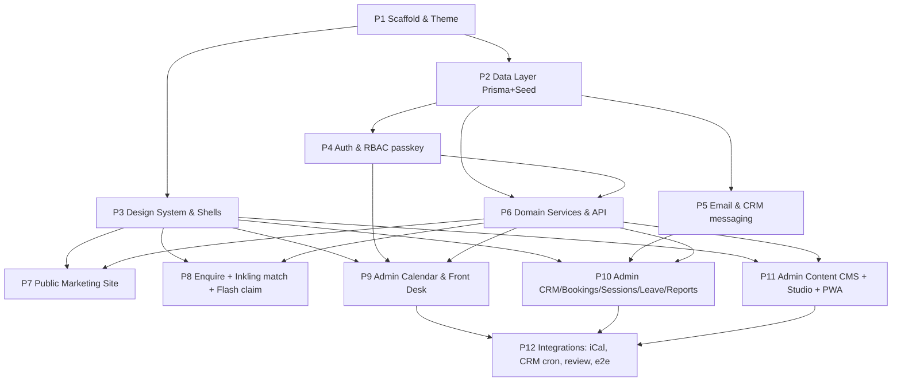
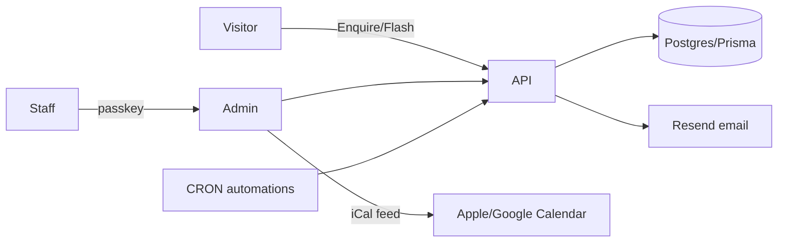

# Boots 'n' Bandit Platform Master Plan

Created: 2026-06-19
Status: IN_PROGRESS
Approved: Yes
Iterations: 1
Worktree: No
Type: Master

## Goal

Ship a production-grade tattoo-studio platform for Boots 'n' Bandit as **one Next.js 15 (App Router, TypeScript) codebase** with two surfaces: a faithful public marketing site `(site)` and an installable staff PWA `(admin)` that **replaces third-party booking tools (Fresha / getink.app)** — calendars, CRM with a full email lifecycle, enquiry→booking→session→receipt, availability/leave, per-artist reporting, and a content CMS for everything the public site shows. No payment processing (bank transfer; we record amounts, issue receipts, and report).

## Architecture

## Context (shared by all phases)

**Source of truth:** `docs/PROJECT-BRIEF.md` (stack, roles, status), `docs/BACKOFHOUSE-IA.md` (admin IA + 12 screen areas + CRM lifecycle), `design-src/` (imported design: `styles.css` brand foundation/tokens, `data.jsx` canonical seed content, `index.html` shell). Every child planner MUST read these first. `design-src/` is reference only — **excluded from test-companion requirements** (do not add tests for it; configure sentinal ignore for that path).

**Stack & conventions:**
- Next.js 15 App Router + TypeScript (strict). Route groups: `app/(site)` public, `app/(admin)` staff PWA, `app/api/*` route handlers. Server Components by default; client components only where interactive (calendar, forms, drawers).
- Tailwind CSS with the heritage tokens ported from `design-src/styles.css` into the Tailwind theme + a `globals.css` (CSS custom properties: `--bb-crimson #c92f4d`, `--bb-gold #cfa05a`, `--bb-teal #36b0a8`, warm-black surfaces). shadcn/ui components themed to these tokens. Icons: `lucide-react`. Display fonts Pirata One + Cinzel (Google Fonts); body = system stack; Termina optional.
- Data: PostgreSQL + Prisma. Local dev: Docker Compose Postgres. `prisma migrate` + a seed script importing `design-src/data.jsx` content (7 artists, 26 gallery, 9 flash, 5 services, 7 FAQ, 9 styles, 10 placements, studio facts).
- Auth: email + **passkey (WebAuthn)** via `@simplewebauthn/server` + `@simplewebauthn/browser`. Encrypted session cookie (e.g. `iron-session` or `jose` JWT). Roles `ARTIST` | `OWNER`; owner = full admin. `RoleGate` + server-side `requireRole()`.
- Email: **Resend** + **React Email** templates. Types: confirmation, reminder, receipt, aftercare, review-request, enquiry-ack, loyalty-reward. Every send logged to a `MessageLog` row on the customer timeline. Respect marketing/consent flags.
- Money: store integer **pence**, GBP. No gateway. Receipts reference bank-transfer.
- A11y/UX (from ui-ux-pro-max): touch targets ≥44px, contrast ≥4.5:1, visible focus rings, 150–300ms transitions, `prefers-reduced-motion`, responsive 375/768/1024/1440, charts have legend/tooltip/empty/loading + table alt, currency uses tabular figures.

**Domain model (Prisma — finalized in P2):**
`User`(staff: email, role, displayName, active) · `Authenticator`(WebAuthn credential per user) · `Artist`(profile: linked User?, name, role, styles[], bio, rates, insta, booksStatus open|limited|closed, hue, specials[], headshot, portfolio, sortOrder) · `Customer`(name, email, phone, notes, marketingConsent, loyalty stamps/tier, tags[]) · `Enquiry`(customer?, contact, preferredArtist?, style, placement, size, budget, description, moodboard images[], status new|replied|converted|closed, source web|flash|inkling) · `Booking`(customer, artist, type consult|session|flash, style?, placement?, start, end, durationMin, priceEstimatePence, depositPence?, status enquiry|pending|confirmed|completed|cancelled|no_show, chair?, notes, remindersOptIn) · `Session`(booking, completedAt, amountChargedPence, tipPence?, bankRef?, receiptSentAt?, aftercareSentAt?, reviewRequestAt?) · `AvailabilityRule`(artist, weekday, startTime, endTime) · `Leave`(artist, startDate, endDate, reason, status) · `Chair`/`Resource`(name, active) · `GalleryItem`(artist, style, title, placement, image, featured, sortOrder) · `Flash`(artist, title, image, sizeCm, pricePence, total, claimed, deadline, status) · `TattooStyle`(name, sortOrder) · `AftercareStage`(order, title, body) · `Faq`(question, answer, sortOrder) · `LoyaltyConfig`(stampsPerVisit, spendPerStamp, rewardThreshold, rewardDesc, expiryMonths, messaging) · `SiteSettings`(studio details, hours, tickerLines[], socials, enquiriesOpen, visualDirection) · `MessageLog`(customer, type, channel, subject, status, sentAt, relatedBooking?) · `CalendarFeed`(artist, token) · `ReviewRequest`/`Review`(booking, rating, body, status).

**Formula-based artist matching (Inkling, P8):** deterministic scoring — match enquiry style/placement/size against each artist's `styles[]`/`specials[]` + `booksStatus`, rank, suggest top 2–3, then create an `Enquiry`. No AI/image generation.

**Imagery:** seed with procedural `Plate` placeholders (port from `design-src`); admin CMS `ImageUploader` stores real uploads (local `public/uploads` or DB blob in dev; pluggable). Brand logo = inline SVG mark.

## Waves

**Wave 1 — Bootstrap (solo):** P1 must land first; the Next app, theme, and folder structure everything else builds on.
**Wave 2 — Foundation (parallel):** P2 (database) and P3 (design system/shells) are independent — one is data, the other is UI primitives.
**Wave 3 — Core services (parallel):** P4 auth, P5 email, P6 domain API. Independent directories (`lib/auth`, `lib/email`, `lib/services`+`app/api`); P6 consumes P4's `requireRole` but the contract is defined in the master plan so they build concurrently.
**Wave 4 — Presentation (parallel):** P7/P8 public, P9/P10/P11 admin. Independent route areas; all consume P3 shell + P6 API (+ P4/P5 for admin). Admin nav registry is defined in P3 so P9–P11 don't edit shared nav files.
**Wave 5 — Integration (parallel where possible):** P12 wires cross-cutting integrations + automations + end-to-end verification once surfaces exist.

## Phases

| Phase | Wave | Title | Objective | Dependencies |
| ----- | ---- | ----- | --------- | ------------ |
| 1 | 1 | Scaffold & Theme | Next 15+TS app, Tailwind, shadcn/ui, heritage tokens ported, `(site)`+`(admin)` route groups, base layouts, tooling, sentinal ignore for `design-src/` | None |
| 2 | 2 | Data Layer | Prisma schema (full domain model), Docker Postgres (**`docker-compose.yml` + `.env.example` are explicit deliverables**), migrations, seed from `design-src/data.jsx` | P1 |
| 3 | 2 | Design System & Shells | Port primitives (Button/Chip/Tag/Plate/Filigree/Card/Field/StatusBadge/sechead), public Nav/Ticker/Footer, admin AppShell (sidebar/topbar/bottomnav + nav registry + RoleGate), **and typed stub shells + prop interfaces for the shared admin components (CalendarGrid, BookingDrawer, CustomerTimeline, DataTable, ChartWrapper, ImageUploader) so Wave-4 phases fill them in without colliding** | P1 |
| 4 | 3 | Auth & RBAC | Passkey (WebAuthn) register/login, encrypted sessions, `requireRole`, sign-in + passkey enrolment; **staff-invite creates a token only (invite email sent by P11); auto-create a `CalendarFeed` token row on artist enrolment** | P2 |
| 5 | 3 | Email & CRM Messaging | Resend + React Email templates (confirmation/reminder/receipt/aftercare/review/enquiry-ack/loyalty), send service + `MessageLog` | P2 |
| 6 | 3 | Domain Services & API | Server services + `app/api` for customers, enquiries, bookings, sessions, availability/leave, reports queries, flash claims; **`lib/services/loyalty.ts` stamp-award service; booking conflict-check is leave-aware (a `Leave` row blocks the slot)** | P2 (+P4 contract) |
| 7 | 4 | Public Marketing Site | Home, Artists(+detail), Gallery(filter), Flash, Aftercare/FAQ, Studio, Bandit Pass — from DB, heritage design | P3, P6 |
| 8 | 4 | Enquire + Inkling + Flash claim | Enquiry form, Inkling mood-board capture + formula artist match, flash claim → enquiry, enquiry-ack email; **public review-capture page `/review/[token]` → creates a `Review` row** | P3, P6, P5 |
| 9 | 4 | Admin Calendar & Front Desk | Day/week calendar (drag/resize), booking drawer, artist switcher, front-desk in-studio board + quick-add + presence, dashboards (Today) | P3, P4, P6 |
| 10 | 4 | Admin CRM & Ops | Customers directory + timeline, enquiries triage→convert, bookings list, sessions complete→confirm amount→receipt+aftercare emails, availability/leave, reports+charts | P3, P4, P5, P6 |
| 11 | 4 | Admin Content CMS + Studio + PWA | CMS for gallery/flash/artists/styles/aftercare/FAQ/loyalty/site-settings; studio staff/resources/email-templates/integrations (**Staff screen sends invite emails via P5**); My Profile (**exposes the iCal feed subscribe URL + regenerate action**); PWA manifest + service worker (installable) | P3, P4, P5, P6 |
| 12 | 5 | Integrations & Automation | Per-artist iCal feeds (consume the `CalendarFeed` token from P4), Google Calendar connect stub, CRM cron automations (reminders/aftercare/review/loyalty), end-to-end verification pass | P9, P10, P11 |

## Progress Tracking

- [ ] Phase 1: Scaffold & Theme (Wave 1)
- [ ] Phase 2: Data Layer (Wave 2)
- [ ] Phase 3: Design System & Shells (Wave 2)
- [ ] Phase 4: Auth & RBAC (Wave 3)
- [ ] Phase 5: Email & CRM Messaging (Wave 3)
- [ ] Phase 6: Domain Services & API (Wave 3)
- [ ] Phase 7: Public Marketing Site (Wave 4)
- [ ] Phase 8: Enquire + Inkling + Flash claim (Wave 4)
- [ ] Phase 9: Admin Calendar & Front Desk (Wave 4)
- [ ] Phase 10: Admin CRM & Ops (Wave 4)
- [ ] Phase 11: Admin Content CMS + Studio + PWA (Wave 4)
- [ ] Phase 12: Integrations & Automation (Wave 5)

**Total Phases:** 12 | **Completed:** 0 | **Remaining:** 12

## Risks and Mitigations

| Risk | Likelihood | Impact | Mitigation |
| ---- | ---------- | ------ | ---------- |
| Passkey/WebAuthn complexity (origins, RP ID) on localhost | Med | High | Pin RP ID/origin via env; document localhost setup; P4 ships a working sign-in before admin UI depends on it |
| Calendar drag/resize is the hardest UI | Med | High | P9 isolated; use a proven approach (CSS grid time-slots + dnd); week view read-first, drag as enhancement |
| Wave 4 file overlap in `(admin)` shared nav | Med | Med | P3 owns the admin nav registry + AppShell; P9–P11 only add leaf routes, never edit shared shell |
| Email deliverability without verified domain | Med | Med | Resend test/dev mode + log-to-DB fallback; templates verifiable without live send |
| Cron automations need a scheduler | Low | Med | P12 uses Next route + external cron / `node-cron` in a worker; idempotent jobs keyed off state |
| Real images absent | Low | Low | Placeholders + CMS upload by design (user-approved) |

## Pre-Mortem

1. **Auth contract drift** (P4↔P6/P9–P11) → Trigger: admin route handlers can't get the current user/role in first integration. Mitigation: master plan fixes `requireRole()`/session helper signature now.
2. **Schema churn** (P2) → Trigger: P6/P9–P11 need fields not in schema, forcing migrations mid-wave. Mitigation: schema in this plan is comprehensive; P2 is Wave 2 and reviewed before Wave 3/4 start.
3. **Booking status model mismatch** → Trigger: enquiry→booking→session lifecycle can't represent a real flow (e.g. flash claim, no-show). Mitigation: status enums fixed in Context; verified by an end-to-end happy path in P12.

## Goal Verification

### Truths
1. `npm run build` (or `next build`) succeeds with no type errors after all phases.
2. `prisma migrate` applies and `prisma db seed` loads 7 artists + 26 gallery + 9 flash from `design-src/data.jsx`.
3. A staff user can register a passkey and sign in at `/admin` (no password path exists — grep shows WebAuthn only).
4. Public `/` renders the heritage home from DB content; `/artists`, `/gallery`, `/flash`, `/aftercare`, `/studio` resolve.
5. Submitting the public Enquire form creates an `Enquiry` row and sends an enquiry-ack via the email service (logged in `MessageLog`).
6. In admin, completing a session with a confirmed amount creates a `Session`, sends receipt + aftercare emails, and the customer timeline shows both.
7. Reports return per-artist bookings/capacity/revenue for a date range.
8. Each artist exposes an iCal feed URL (from a `CalendarFeed` token auto-created at enrolment, shown on My Profile) that returns valid `BEGIN:VCALENDAR` with their bookings.
9. Completing a session awards a loyalty stamp per `LoyaltyConfig` (`lib/services/loyalty.ts` increments the customer's stamps).
10. A customer can submit a review at `/review/[token]`, creating a `Review` row shown on their CRM timeline.
11. A `Leave` row for an artist blocks new bookings in that range (conflict-check rejects the slot) and hides them from front-desk "in today".

### Artifacts
| Artifact | Provides | Exports |
| -------- | -------- | ------- |
| `prisma/schema.prisma` | Domain model | All models/enums |
| `lib/auth/*` | Passkey auth + RBAC | `requireRole`, WebAuthn handlers |
| `lib/email/*` | Transactional email | `sendEmail`, templates |
| `lib/services/*` + `app/api/*` | Domain logic + API | bookings/customers/sessions/reports |
| `app/(site)/*` | Public site | marketing routes |
| `app/(admin)/*` | Staff PWA | admin routes + manifest/SW |

### Key Links
| From | To | Via | Pattern |
| ---- | -- | --- | ------- |
| `app/(admin)/**` | `lib/auth` | route protection | `requireRole\(` |
| session complete | `lib/email` | receipt+aftercare | `sendEmail\(.*receipt` |
| `app/api/**` | `prisma` | data access | `prisma\.(booking|customer|session)` |
| enquiry submit | `Enquiry` | lead capture | `prisma\.enquiry\.create` |

## Child Plans
Stubs created at `docs/plans/2026-06-19-boots-n-bandit-platform-phase-{1..12}.md` (PENDING, Approved: No). Each is planned in dependency/wave order via `/spec <stub>` then implemented.
